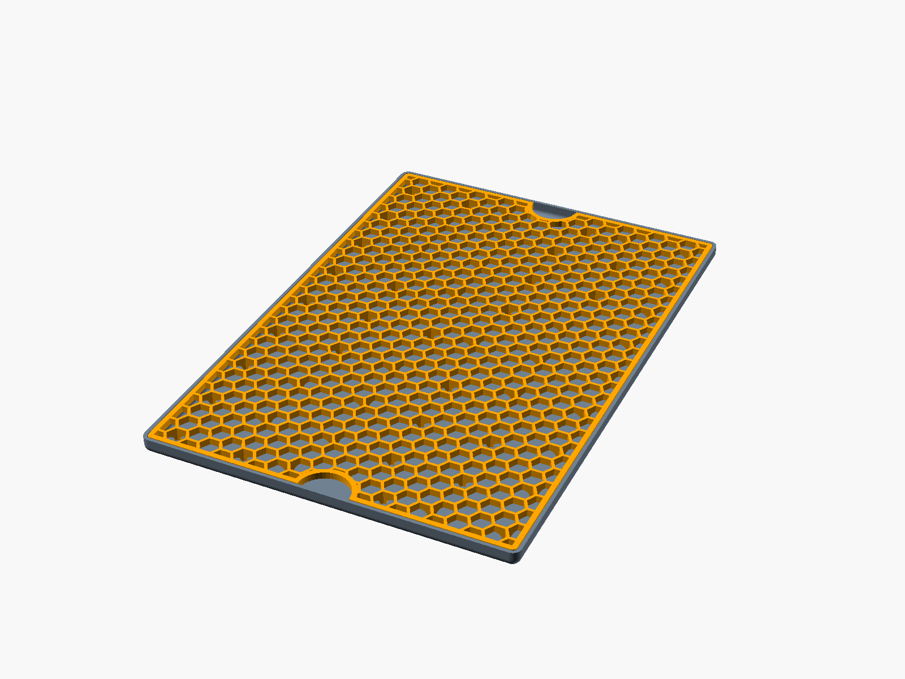

# drip-tray

Parametric OpenSCAD drip tray with a removable hexagonal grid insert. The grid
sits flush with the tray rim and stands on small filleted legs hidden under the
hex walls. Optional finger notches on the short edges make it easy to lift out.

More views: [section](build/section.png), [exploded](build/exploded.png),
[grid in print orientation](build/grid_print.png). `build/review.html` shows
them all together with the current parameters.

## Usage

Requires OpenSCAD (a recent build with the Manifold backend), make and python3.

    make help      # list targets
    make all       # screenshots, review page and STL files in build/

Ready-to-print STL files are committed in `build/`:

- `tray.stl`: the tray
- `grid.stl`: the grid, upside down with its plate on the bed
- `print_plate.stl`: both side by side (needs a 445 x 320 mm bed)

## Parameters

All dimensions are in mm and declared at the top of `drip_tray.scad`, also
editable in the OpenSCAD Customizer. The main ones:

- `tray_size`: outer width, length and height (default 220 x 320 x 10)
- `wall`, `corner_radius`: tray wall thickness and rounding
- `clearance`: gap between grid and tray wall
- `grid_thickness`: hex plate thickness; the legs fill the rest of the height
- `hex_radius`, `hex_web`: hex hole size and wall width
- `leg_spacing`, `leg_foot`: leg distribution and foot size
- `finger_notches`, `notch_radius`: lift-out notches

Grid size and leg height are derived, so the grid stays flush at any size.
Use `part` to render a single part, e.g.
`openscad -D 'part="grid_print"' -o grid.stl drip_tray.scad`.

## License

MIT, see [LICENSE.md](LICENSE.md).
